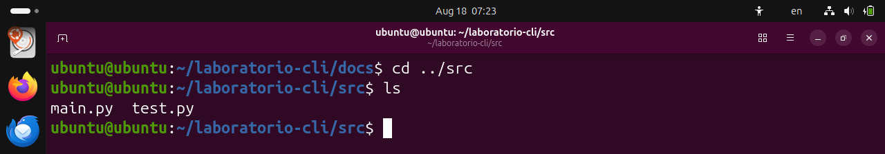
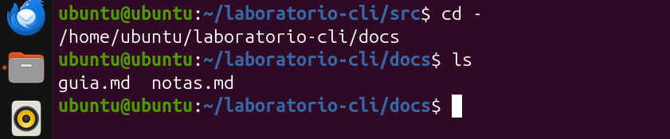
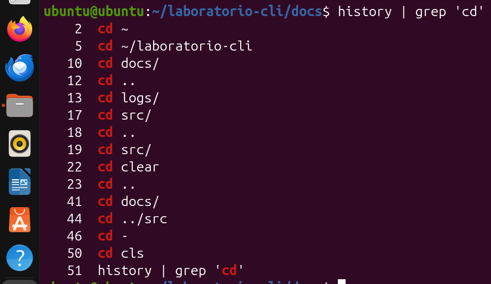
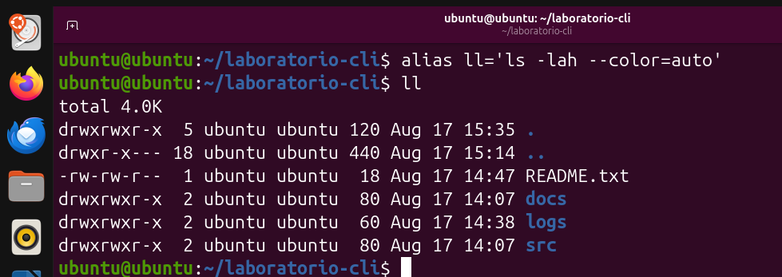
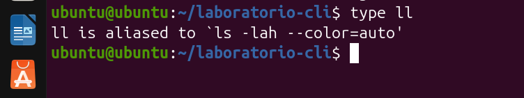
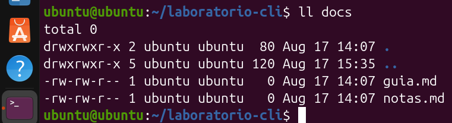
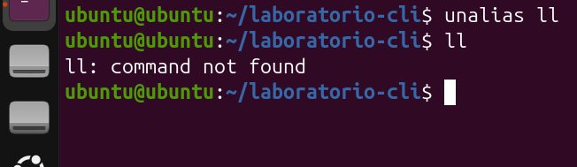

# Laboratorio CLI: Análisis de Ejecución de Comandos en Terminal

Este documento describe paso a paso las acciones y comandos ejecutados en la terminal de Linux, documentados en las capturas proporcionadas.

## 1. Navegación entre Directorios
En la primera imagen, el usuario se encuentra en el directorio `~/laboratorio-cli/docs`. Utiliza el comando `cd ../src` para retroceder un nivel de directorio y entrar a la carpeta `src`. Al ejecutar el comando `ls`, se listan los archivos contenidos en ese directorio: `main.py` y `test.py`.
  

  

Posteriormente, el usuario utiliza el comando `cd -`. Este es un atajo muy útil que sirve para regresar exactamente al directorio en el que se encontraba antes del último cambio (en este caso, regresa a `/home/ubuntu/laboratorio-cli/docs`). Un comando `ls` posterior confirma la ubicación al mostrar los archivos `guia.md` y `notas.md`.
  

  

## 2. Búsqueda en el Historial de Comandos
El usuario ejecuta `history | grep 'cd'`. Aquí se están combinando dos comandos mediante un "pipe" (`|`): `history` muestra todo el historial de comandos ejecutados, y se pasa ese resultado a `grep 'cd'`, el cual filtra y muestra únicamente aquellas líneas del historial que contienen la palabra `cd`.
  

  

## 3. Creación y Verificación de Alias
Se procede a crear un atajo de comando (alias) escribiendo `alias ll='ls -lah --color=auto'`. Esto significa que al escribir `ll`, la terminal ejecutará la versión extendida de `ls` (mostrando todos los archivos incluyendo ocultos, en formato de lista, con tamaños legibles por humanos, y con colores). Inmediatamente después, el usuario ejecuta `ll` para listar el directorio actual con todo detalle.
  

  

Para comprobar la definición del alias, se ejecuta el comando `type ll`. La terminal responde confirmando que `ll is aliased to 'ls -lah --color=auto'`, lo que permite al usuario saber con exactitud qué comando real se esconde detrás del alias.
  

  

El alias funciona como un comando normal, por lo que acepta argumentos. Al ejecutar `ll docs`, el alias se aplica directamente a esa carpeta, mostrando el contenido detallado únicamente del directorio `docs`.
  

  

## 4. Eliminación de Alias
Finalmente, el usuario decide eliminar el alias creado utilizando el comando `unalias ll`. Para comprobar que la eliminación fue exitosa, intenta ejecutar de nuevo `ll`. La terminal arroja un error: `ll: command not found` (comando no encontrado), lo que confirma que el atajo ya no existe en la sesión actual.
  

